# ctz-trigo

Draw the trigonometric unit circle, after `\CercleTrigo` from Cédric
Pierquet's LaTeX package [ProfLycee](https://ctan.org/pkg/proflycee):
remarkable values and angles, tangent line, points, rays, arcs, angles,
winding of the real line, solutions of `cos x = cos α` and `sin x = sin α`.
It is built on [CeTZ](https://typst.app/universe/package/cetz) (version 0.5.2,
see [src/deps.typ](src/deps.typ)).

```typ
#import "@preview/ctz-trigo:0.1.0": *

#trig-circle(radius: 2)
```

Everything goes through one function, `trig-circle(keys, ..elements)`: keys
set up the circle, elements (`tc-point`, `tc-ray`…) add what you want on it.

```typ
#trig-circle(
  radius: 2,
  remarkable: false,
  tc-point(80deg, $A$),
  tc-ray(1rad, $B$, arrow: true),
  tc-arc(0, 1rad),
)
```

## Examples

Click a drawing to see its code.

<!-- exemples : partie refaite par exemples/readme.sh, ne pas modifier à la main -->
### 1. The full circle, as in ProfLycee

<details>
<summary>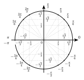</summary>

```typ
#trig-circle(
  radius: 2,
)
```

</details>

<details>
<summary>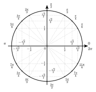</summary>

```typ
#trig-circle(
  radius: 2.5,
  minus-pi: false,
)
```

</details>

### 2. Choosing what is shown

<details>
<summary>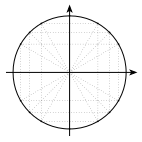</summary>

```typ
#trig-circle(
  radius: 2,
  show-values: false,
  show-angles: false,
  show-points: true,
)
```

</details>

<details>
<summary>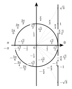</summary>

```typ
#trig-circle(
  radius: 1.55,
  show-tan: true,
  show-lines: false,
  show-angles: false,
  show-values: false,
)
```

</details>

### 3. A bare circle in its frame: `remarkable: false`

<details>
<summary>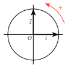</summary>

```typ
#trig-circle(
  radius: 1.5,
  remarkable: false,
  show-origin: true,
  show-vectors: true,
  show-direction: true,
)
```

</details>

<details>
<summary>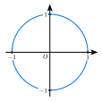</summary>

```typ
#trig-circle(
  radius: 1.5,
  remarkable: false,
  show-origin: true,
  show-ticks: true,
  circle-color: blue,
)
```

</details>

### 4. Points, rays, arcs and angles

<details>
<summary>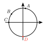</summary>

```typ
#trig-circle(
  radius: 1,
  remarkable: false,
  show-ticks: false,
  tc-point(80, $A$),
  tc-point(0.8 * calc.pi * 1rad, $B$),
  tc-point(180deg, $C$),
  tc-point(-90, $D$, color: red),
)
```

</details>

<details>
<summary>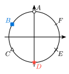</summary>

```typ
#trig-circle(
  radius: 1.5,
  remarkable: false,
  tc-point(90, $A$, mark: "o"),
  tc-point(150, $B$, mark: "square*", color: blue),
  tc-point(210, $C$, mark: "triangle"),
  tc-point(270, $D$, mark: "star*", color: red),
  tc-point(330, $E$, mark: "x", mark-size: 0.25),
  tc-point(30, $F$, mark: "|"),
)
```

</details>

<details>
<summary>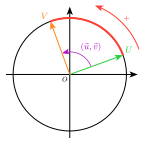</summary>

```typ
#trig-circle(
  radius: 2,
  remarkable: false,
  show-axes: false,
  show-origin: true,
  tc-angle(0, 1rad, $1 "rad"$, color: black, fill: gray.lighten(70%)),
  tc-ray(0, $A$),
  tc-ray(1rad, $B$),
  tc-arc(0, 1rad, thickness: 1pt, arrow: true),
)
```

</details>

<details>
<summary>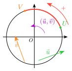</summary>

```typ
#trig-circle(
  radius: 2,
  remarkable: false,
  show-origin: true,
  show-direction: true,
  tc-arc(20, 110),
  tc-point(20, $U$, color: green),
  tc-point(110, $V$, color: orange),
  tc-vector(20, $arrow(u)$, from: (0.15, -0.85), color: green),
  tc-vector(110, $arrow(v)$, from: (-0.35, -0.9), color: orange),
  tc-angle(20, 110, $(arrow(u), arrow(v))$),
)
```

</details>

### 5. Wrapping the real line around the circle

<details>
<summary>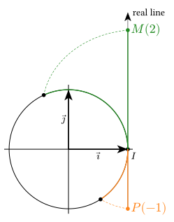</summary>

```typ
#trig-circle(
  radius: 3,
  remarkable: false,
  show-vectors: true,
  tc-wind(2, $M(2)$),
  tc-wind(-1, $P(-1)$, color: orange),
)
```

</details>

<details>
<summary>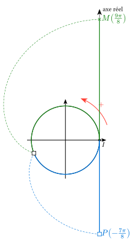</summary>

```typ
#trig-circle(
  radius: 3,
  remarkable: false,
  show-direction: true,
  real-line-label: [axe réel],
  tc-wind(9 * calc.pi / 8, $M((9pi)/8)$),
  tc-wind(-7 * calc.pi / 8, $P(-(7pi)/8)$, color: blue),
)
```

</details>

### 6. Cosine, sine, equations

<details>
<summary>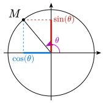</summary>

```typ
#trig-circle(
  radius: 2.5,
  remarkable: false,
  tc-cos-sin(130deg),
)
```

</details>

<details>
<summary>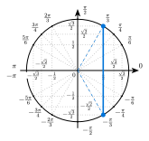</summary>

```typ
#trig-circle(
  radius: 2,
  tc-cos-eq(60),
)
```

</details>

<details>
<summary>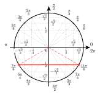</summary>

```typ
#trig-circle(
  radius: 2,
  minus-pi: false,
  tc-sin-eq(-30, color: red),
)
```

</details>

### 7. In your own canvas: `trig-circle-draw`

<details>
<summary>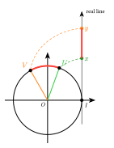</summary>

```typ
#cetz.canvas(length: 1.5cm, {
  let (x, y) = (70deg.rad(), 120deg.rad())
  trig-circle-draw(
    radius: 1,
    remarkable: false,
    show-origin: true,
    tc-arc(70deg, 120deg),
    tc-ray(70deg, $U$, color: green),
    tc-ray(120deg, $V$, color: orange),
    tc-wind(x, $x$, segment: false, arc: false),
    tc-wind(y, $y$, color: orange, segment: false, arc: false),
  )
  cetz.draw.line((1, x), (1, y), stroke: red + 2pt)
})
```

</details>
<!-- fin des exemples -->

## Angles

Everywhere an angle is expected, give a number of degrees (`45`) or a Typst
angle (`45deg`, `calc.pi / 4 * 1rad`, `1rad`). The only exception is
`tc-wind(x)` (and `tc-interval`), which takes a real number: a point of the
real line, not an angle.

## `trig-circle` keys

`trig-circle(..)` makes its own canvas (1 unit = 1 cm);
`trig-circle-draw(..)` takes the same arguments and gives the CeTZ elements
alone, to put in your own `cetz.canvas` (example 7).

| Key | Default | Meaning |
|---|---|---|
| `radius` | `3` | radius of the circle, in cm |
| `thickness` | `1pt` | thickness of the circle and axes |
| `margin` | `0.25` | how far the axes go beyond the circle |
| `circle-color` | `black` | color of the circle |
| `remarkable` | `true` | `false` hides the remarkable values, angles and lines at once |
| `show-values` | `true` | remarkable values of cos and sin on the axes |
| `show-angles` | `true` | remarkable angles around the circle |
| `show-lines` | `true` | dotted construction lines |
| `show-points` | `auto` | points of the remarkable angles (`auto`: with the angles and the lines) |
| `minus-pi` | `true` | angles in ]−π ; π] (`false`: in [0 ; 2π[) |
| `show-tan` | `false` | tangent line at I with the values of tan |
| `show-axes` | `true` | axes |
| `show-origin` | `false` | name O of the origin |
| `show-ticks` | `false` | ticks ±1 on the axes |
| `show-vectors` | `false` | vectors i and j (the axes then lose their arrow) |
| `show-direction` | `false` | red arrow “+” of the positive direction |
| `show-real-line` | `auto` | real line tangent at I (`auto`: if there is a `tc-wind` or a `tc-interval`) |
| `real-line-label` | `[real line]` | label of the real line |
| `values-size` | `7pt` | text size of the values |
| `angles-size` | `8pt` | text size of the angles |
| `names-size` | `9pt` | text size of the names of the elements |
| `angles-offset` | `10pt` | distance from the circle to the angles |
| `background` | `white` | background behind values and angles |

Beyond a radius of 1, everything added to the circle grows with it, half as
fast as the radius (twice as big at radius 3): the elements (names, points, arrow heads) and the frame (O, ticks,
i and j, I, real line, positive direction). Line thicknesses do not change,
nor do the remarkable values and angles of ProfLycee.

## Elements

Each element takes its angle(s), then an optional name, then keys. Names are
placed outside the circle, never across an axis.

| Element | Keys (default) | Draws |
|---|---|---|
| `tc-point(angle, name)` | `color` (`black`), `anchor` (`auto`), `mark` (`"*"`), `mark-size` (`auto`) | a point of the circle; `mark`: `"*"`, `"o"`, `"square"`, `"triangle"`, `"diamond"`, `"star"` (a final `*` fills them: `"square*"`…), `"+"`, `"x"`, `"\|"` (radial), `"-"` (tangent) or `none`; `mark-size`: width in cm (`auto`: 0.1 for `"*"`, 0.15 otherwise) |
| `tc-ray(angle, name)` | `color` (`black`), `thickness` (`auto`: the circle's), `arrow` (`false`), `label` (`none`), `copy` (`none`), `copy-name` (`none`) | a ray from O (a vector with `arrow: true`); `label` in the middle; `copy: (x, y)`: another representative of the vector, starting at (x, y) in radii |
| `tc-vector(angle, name)` | `from` (`(0, 0)`), `length` (`1`), `color` (`black`), `thickness` (`auto`) | a vector of direction `angle`, anywhere: `from` is its origin, a point `(x, y)` in radii or an angle (that point of the circle); `length` in radii; the name goes in the middle, on its left |
| `tc-arc(from, to, name)` | `color` (`red`), `thickness` (`2pt`), `arrow` (`false`) | an arc of the circle |
| `tc-angle(from, to, name)` | `color` (`purple`), `radius` (`0.4`, in radii), `fill` (`none`) | an angle at the centre |
| `tc-wind(x, name)` | `color` (green), `segment` (`true`), `arc` (`true`) | the real `x` wound on the circle: segment from I to M(1 ; x), arc from I, spiral |
| `tc-interval(from, to)` | `color` (`red`), `thickness` (`2pt`) | a segment of the real line |
| `tc-cos-eq(angle)` | `color` (`blue`), `lines` (`true`) | the two solutions of cos x = cos α |
| `tc-sin-eq(angle)` | `color` (`blue`), `lines` (`true`) | the two solutions of sin x = sin α |
| `tc-cos-sin(angle, name)` | `angle-name` (`$theta$`); name: `$M$` | M(cos θ ; sin θ) with its projections |

Elements are drawn kind by kind, points last (on top).

## From ProfLycee

| `\CercleTrigo` key | ctz-trigo |
|---|---|
| `Rayon`, `Epaisseur`, `Marge` | `radius`, `thickness`, `margin` |
| `TailleValeurs`, `TailleAngles`, `CouleurFond`, `Decal` | `values-size`, `angles-size`, `background`, `angles-offset` |
| `MoinsPi`, `AffAngles`, `AffTraits`, `AffValeurs`, `ValeursTan` | `minus-pi`, `show-angles`, `show-lines`, `show-values`, `show-tan` |
| `EquationCos`, `cos`, `CouleurSol`, `AffTraitsEq` | `tc-cos-eq(angle, color: …, lines: …)` |
| `EquationSin`, `sin` | `tc-sin-eq(angle)` |
| `Point`, `NomPt`, `Angle` | `tc-cos-sin(angle, name, angle-name: …)` |

Everything else is an addition of ctz-trigo.

## License

MIT, see [LICENSE](LICENSE).
