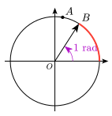

# ctz-trigo

*Draw the trigonometric unit circle with CeTZ, after ProfLycee's
`\CercleTrigo`. Documentation in French below.*

**Documentation : https://amjmeyer.github.io/ctz-trigo/**

Le cercle trigonométrique en Typst, d'après `\CercleTrigo` du paquet LaTeX
[ProfLycee](https://ctan.org/pkg/proflycee) de Cédric Pierquet, construit
avec [CeTZ](https://typst.app/universe/package/cetz).



```typ
#import "@preview/ctz-trigo:0.1.0": *

#trig-circle(
  radius: 2,
  remarkable: false,
  show-origin: true,
  tc-point(80deg, $A$),
  tc-ray(1rad, $B$, arrow: true),
  tc-arc(0, 1rad),
  tc-angle(0, 1rad, $1 "rad"$),
)
```

## Licence

MIT, voir [LICENSE](LICENSE).
